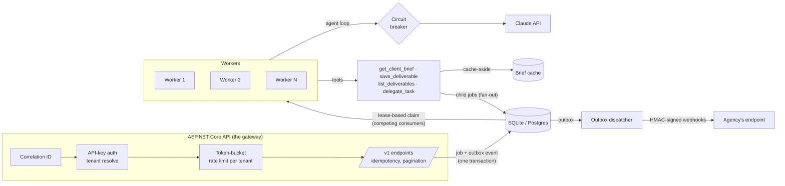

# Agency Harness (.NET 8)

An operations platform for a digital agency where **Claude agents do the client work**. Account
managers create clients and projects, then queue jobs for specialist agents: strategist, copywriter,
SEO, analyst and reviewer. A pool of workers runs the jobs. Agents read the client brief, save
deliverables and can delegate subtasks to other agents. Every step is metered, retried, audited and
announced by webhook.

It's built on the patterns in this repo's [System Design 101](../README.md). See
**[docs/STUDY-GUIDE.md](docs/STUDY-GUIDE.md)** for a topic-by-topic map from those diagrams to the code.



## Quick start

```bash
cd agency-harness
dotnet test                                   # 18 tests: unit + full HTTP integration
cd src/AgencyHarness
export ANTHROPIC_API_KEY=sk-ant-...           # optional; without it a scripted runner fakes the model
ASPNETCORE_ENVIRONMENT=Development dotnet run --urls http://localhost:5077
```

Then:

```bash
B=http://localhost:5077
# 1. Provision an agency (tenant). The API key is shown once.
curl -s -X POST $B/admin/tenants -H "X-Admin-Key: dev-admin-key-change-me" \
     -H 'Content-Type: application/json' -d '{"name":"Demo Agency","monthlyBudgetUsd":50}'
K=ak_...   # apiKey from the response

# 2. Client → project
curl -s -X POST $B/v1/clients -H "X-Api-Key: $K" -H 'Content-Type: application/json' \
     -d '{"name":"Bloom Coffee","brief":"Warm, witty voice. Audience: remote workers 25-40."}'
curl -s -X POST $B/v1/clients/<clientId>/projects -H "X-Api-Key: $K" -H 'Content-Type: application/json' \
     -d '{"name":"Spring launch","goal":"Grow subscriptions 20%"}'

# 3. Queue work (safe to retry thanks to Idempotency-Key)
curl -s -X POST $B/v1/projects/<projectId>/jobs -H "X-Api-Key: $K" -H 'Idempotency-Key: launch-plan-1' \
     -H 'Content-Type: application/json' -d '{"role":"strategist","instructions":"Plan the spring launch"}'

# 4. Watch it happen
curl -s $B/v1/projects/<projectId> -H "X-Api-Key: $K"
curl -s $B/v1/projects/<projectId>/deliverables -H "X-Api-Key: $K"
curl -s $B/v1/events -H "X-Api-Key: $K"
```

## API

| Method | Path | Notes |
|---|---|---|
| POST | `/admin/tenants` | `X-Admin-Key`. Returns `apiKey` and `webhookSecret` once |
| GET | `/v1/me` | Tenant, limits, month-to-date spend |
| GET | `/v1/roles` | Agent roster with each role's effort level and tools |
| POST/GET | `/v1/clients` | Cursor pagination: `?cursor=&limit=` |
| PUT | `/v1/clients/{id}/brief` | Updates the brief and invalidates the cache |
| POST | `/v1/clients/{id}/projects` | |
| GET | `/v1/projects/{id}` | Project and job counts by status |
| POST | `/v1/projects/{id}/jobs` | `202 Accepted`; honours `Idempotency-Key` |
| GET | `/v1/projects/{id}/jobs` | `?status=DeadLettered` gives the DLQ view |
| GET | `/v1/jobs/{id}` | Status, attempts, error, tokens, cost |
| POST | `/v1/jobs/{id}/cancel` | Only Queued or Failed jobs |
| POST | `/v1/jobs/{id}/retry` | Puts a dead-lettered job back on the queue |
| GET | `/v1/projects/{id}/deliverables` | |
| GET | `/v1/usage` | Monthly ledger roll-up |
| GET | `/v1/events?after=` | Event log (also delivered as webhooks) |
| GET | `/health/live`, `/health/ready` | Readiness includes the model circuit state |

### Webhooks

Set `webhookUrl` on the tenant. Each event is POSTed with these headers:

- `X-Harness-Event-Id`: use it to drop duplicates (delivery is at-least-once)
- `X-Harness-Event-Type`: `job.queued`, `job.succeeded` or `job.dead_lettered`
- `X-Harness-Timestamp` and `X-Harness-Signature`: `v1=` + hex HMAC-SHA256(secret, `"{timestamp}.{body}"`)

Check the signature with a constant-time compare, and reject timestamps older than 5 minutes.

## Job lifecycle

```
Queued ──claim──▶ Running ──ok──▶ Succeeded
   ▲                 │
   │   transient     ├──▶ Failed ──(backoff + jitter)──▶ claimable again
   │   error         │
   │                 └──▶ DeadLettered   (permanent error, retries exhausted, or budget hit)
   └──────── POST /retry ────────┘
Running with an expired lease (the worker crashed) ──▶ claimable again
```

## Configuration (`appsettings.json` → `Harness`)

| Key | Default | Purpose |
|---|---|---|
| `AdminKey` | (empty: admin API disabled) | Operator key for tenant provisioning |
| `Claude:Model` | `claude-opus-5-5` | Model for all roles. Each role sets its own effort level |
| `Claude:UseServerSideFallback` | `true` | If the model declines a request, the API re-serves it with a fallback model in the same call |
| `Claude:MaxTurns` | `12` | Cap on agent loop turns per job |
| `Worker:Concurrency` | `4` | Competing consumers per process |
| `Worker:Lease` | `00:05:00` | Visibility timeout. Extended by a heartbeat on every agent turn |
| `Circuit:FailureThreshold` / `OpenSeconds` | `5` / `30` | Model circuit breaker |
| `RunWorkers` | `true` | Set to `false` to run an API-only node |

## Going to production

- **Postgres** instead of SQLite. Claim jobs with `SELECT … FOR UPDATE SKIP LOCKED` and use EF migrations instead of `EnsureCreated`.
- **Redis** (`IDistributedCache`) for the brief cache and auth cache once you run more than one node.
- **Separate deployables.** Run API nodes with `RunWorkers=false` and scale worker nodes on queue depth.
- **OpenTelemetry exporter** for the `AgencyHarness` meter and ASP.NET traces.
- **Secrets.** Keep `ANTHROPIC_API_KEY` and `AdminKey` in a vault, not in appsettings.
