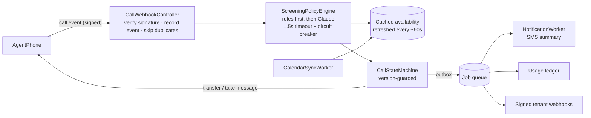

# AI receptionist: research and proposed architecture

The goal is a phone receptionist for Agency Harness. It answers calls, screens the caller, decides
whether the call matters and whether you're free, then either transfers the call to you or takes a
message and texts you a summary. Telephony is AgentPhone. This doc compares open-source AI
receptionist projects, takes the lessons that apply to us, and proposes the module design.

Researched 2026-11-15 from each project's README and docs. Items marked **(?)** are not stated in
those sources and need checking before we build on them.

## Open-source projects compared

| Project | Stars | Telephony | Speech | Human handoff | Availability | Notable |
|---|---|---|---|---|---|---|
| [AIReceptionist](https://github.com/kirklandsig/AIReceptionist) | ~170 | SIP trunk into LiveKit | Speech-to-speech (OpenAI Realtime) | SIP REFER to departments or people | Google Calendar `check_availability` and `book_appointment` tools | Spoken consent notice; retries messages then writes failures to a folder; webhooks are **not signed** |
| [Pipecat](https://github.com/pipecat-ai/pipecat) | ~17k | Twilio, Telnyx, Plivo, Vonage, Daily | Chained or speech-to-speech | Up to you (carrier API) **(?)** | Pipecat Flows holds conversation state | Detects when the caller has finished speaking; handles interruptions; OpenTelemetry tracing |
| [LiveKit Agents](https://github.com/livekit/agents) | ~15k | LiveKit SIP | Any mix | Agents hand off to other agents; warm transfer to a human **(?)** | Up to you | A server hands each call to a pool of worker processes; turn-taking model |
| [Dograh](https://github.com/dograh-hq/dograh) | ~6k | Twilio, Vonage, Telnyx, Plivo, Asterisk | Bring your own models | Call transfer on supported providers | Not stated | Built on Pipecat; deploys with Docker; QA step and webhooks |
| [Bolna](https://github.com/bolna-ai/bolna) | ~800 | Twilio, Plivo | Separate speech-to-text, LLM and text-to-speech steps | Not stated | Not stated | Agent definitions stored in Redis |

Vocode was excluded because it has had no commits since November 2024.

## Lessons for our design

| # | Lesson | System Design 101 concept |
|---|---|---|
| 1 | A call has a hard time limit. Decide what happens to it in about 2 seconds. If Claude hasn't answered in about 1.5 seconds, take a message | Latency budgets |
| 2 | The webhook only decides where the call goes. The summary, SMS, ledger entry and outbound webhooks all go on the job queue | Synchronous vs asynchronous work, message queues |
| 3 | Each call has an explicit status: `Ringing → Screening → Deciding → Transferring \| TakingMessage → Completed/Failed`, guarded by a version column | State machines, optimistic concurrency, fencing |
| 4 | Store each incoming event's ID in a table that rejects duplicates, and check the provider's signature | Idempotency, webhook security |
| 5 | If Claude, Google Calendar or SMS is down, take a message. Never transfer blindly and never drop the call | Circuit breaker, graceful degradation |
| 6 | Check fixed rules first (VIP list, blocklist, quiet hours). Claude only classifies importance, and only our own code can start a transfer | Cheap paths before expensive ones, least privilege |
| 7 | Keep a cached copy of your availability, refreshed every 60 seconds or so by a background sync. Never call the Calendar API while a caller waits | Cache-aside, read-path optimization |
| 8 | Give each call one trace ID, record how long each step took, and alert on how often calls fall back and on slow decisions | Observability |
| 9 | Play a consent notice, encrypt transcripts, store caller numbers as hashes, and delete old data on a schedule | Security, data retention |
| 10 | Replay recorded call scenarios against the screening prompt in CI | Testing, reliability |

## Proposed module

**Live call path (target under 2 seconds):**
1. Verify the event's signature and skip it if we've seen its ID before.
2. Load the tenant, the caller's contact rule and the cached availability.
3. Apply the rules.
4. If no rule decides the call, ask Claude to classify importance, with a 1.5-second limit.
5. Save the new call status and return the action.

**Background path:**
- SMS summary
- ledger and budget
- tenant webhooks
- calendar sync
- retention sweep

Each of these is retried on failure and goes to the dead-letter queue if it keeps failing.

**Data model:**
- `calls(id, tenant_id, provider_call_id UNIQUE, caller_hash, state, version, importance, decision_reason, fallback_used, trace_id, started_at, ended_at)`
- `call_events(id, call_id, provider_event_id UNIQUE, type, payload_enc, received_at)`
- `contacts(tenant_id, caller_hash, name, tier[VIP|normal|blocked], always_transfer)`
- `routing_rules(tenant_id, priority, condition_json, action, transfer_number, quiet_hours)`
- `availability_snapshots(tenant_id, busy_until, next_free, fetched_at)`
- `messages(call_id, summary, transcript_enc, sms_status)`

**When something fails:**

| Failure | What the receptionist does |
|---|---|
| Claude is slow or its circuit is open | Takes a message (`fallback_used=llm`) |
| Calendar copy is more than 10 minutes old | Treats you as busy, unless the caller is a VIP marked always-transfer |
| You don't answer the transfer | Returns the caller to the agent, takes a message, texts you "missed urgent call" |
| SMS provider is down | Retries with backoff, then dead-letter queue, then email |
| Duplicate or out-of-order events | Skipped by the duplicate check and the status guard |
| The tenant's budget is used up | Routes by rules only, without Claude |
| Our API is down | AgentPhone's hosted agent takes a message by default **(?)** |
| Spoofed VIP caller ID | VIP status is a hint, not proof. The agent never reveals your calendar to a caller |

## Still to confirm with AgentPhone

- Does it sign its webhooks?
- How long does it wait for our response?
- Can the webhook mode trigger a live transfer, or is transfer available only for hosted agents with `transfer_number`?
