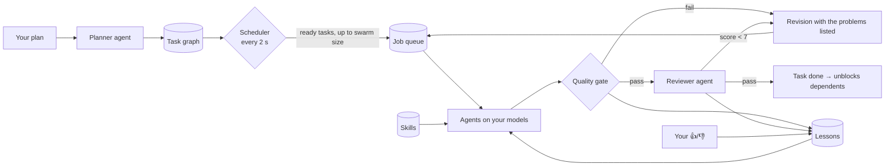

# Agendas, swarms, skills and learning

The harness can take on goal-sized work and get better at it over time, with as little of your
attention as possible.

## How it works

1. **Agenda.** Paste a plan (e.g. the ZUNVI 30-day sprint), choose a swarm size, start it.
2. **Planner.** An agent turns the plan into 6–15 tasks with a role, a phase and dependencies. A task
   can only depend on tasks that already exist, so the graph can't loop.
3. **Swarm.** Every few seconds the scheduler launches each task whose dependencies are done, up to
   the swarm size. Each task builds on its dependencies' summaries and deliverables.
4. **Quality gate.** Every finished job is checked automatically:
   - a deliverable was actually saved
   - it isn't too short
   - none of the brief's "Avoid" terms appear
   - no `[placeholders]` were left in
   - outreach has a CASL unsubscribe line
   - JSON-LD is valid JSON

   For agenda tasks, a reviewer agent then scores the work (pass at 7/10). Failures go back for
   revision, at most twice, with the exact problems listed.
5. **Done.** A failed task blocks only its dependents. The rest of the agenda carries on, and a
   single click retries a failed task.

## Skills: avoiding known mistakes

Skills are playbooks, chosen for each job by role and by keywords in the task:

| Skill | Used for |
|---|---|
| deliverable format | Every job |
| brand voice and "Avoid" list | Writing jobs |
| Canadian local SEO | Bilingual pages, NAP consistency, LocalBusiness JSON-LD |
| GEO / AI-citation writing | Pages meant to be cited by AI search |
| CASL outreach | Outreach drafts |
| valid structured data | JSON-LD and schema work |
| planning a task graph | The planner |
| review rubric | The reviewer |

Your agency can add its own skills. Each skill shows how often it's used and its pass rate: the share
of jobs using it that then passed the quality gate.

## Learning while working

Every failed check, reviewer lesson and 👍/👎 note becomes a **lesson** scoped to that client and
role. Lessons are added to matching jobs, strongest first. A lesson seen again gets stronger instead
of being duplicated, and unused lessons fade (half-life about 60 days). Promote a lesson to turn it
into a permanent skill, or retire it.

## System design choices

| Principle | Where |
|---|---|
| Stateless, idempotent scheduler: decisions are re-derived from the database every tick; restarts just resume | `AgendaScheduler.TickAsync` |
| Deterministic idempotency keys per task, revision and review, so a double tick can't double-launch | `agenda:{task}:r{n}` |
| Bulkhead: swarm size caps concurrency per agenda, so one agenda can't starve others or the model quota | `SwarmSize` |
| Failure isolation: a failed task only blocks its own dependents, and one broken agenda never stops the others | Blocked propagation, per-agenda try/catch |
| Pipeline with gates (automatic checks → reviewer → done) and bounded retries | `QualityGate`, `MaxRevisions` |
| Feedback loop with reinforcement and decay, instead of an ever-growing prompt | `SkillsAndLessons` |
| Event-driven visibility: every transition is an outbox event (webhooks + dashboard) | `agenda.*`, `lesson.learned` |
| Additive schema evolution: new tables are created on start, existing data untouched | `SchemaSync` |

## What agents can't do (yet)

The agents produce specs, copy, schema, scripts and drafts. They don't have access to your database,
Google Search Console or email sending. The planner is told to create "produce the spec or script a
human runs" tasks for those steps instead of pretending.
