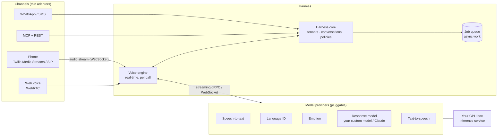
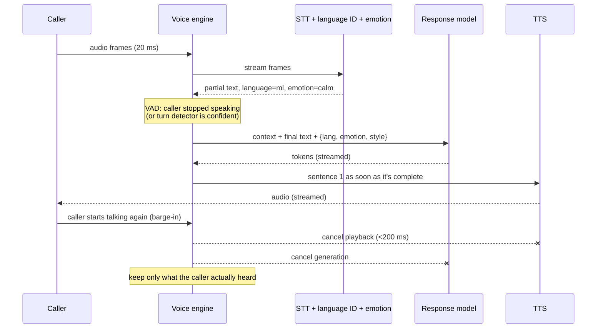

# Voice engine (Vaani): your models, any channel

The harness is the product. The phone receptionist is one **channel**, one way in. Other channels
are web chat, WhatsApp, the dashboard and MCP. Every channel feeds the same harness core, and live
voice gets a real-time engine where **your own models** do the listening, deciding and speaking:

- custom-trained models for the languages you choose, Malayalam first
- quick handling when a caller interrupts (barge-in)
- following the caller when they switch language mid-call
- picking up emotional changes and adapting tone, or handing the call to a human

## Big picture



The harness owns the call, its state, its rules and its records. Channels only move audio or text,
so changing phone carriers or adding WhatsApp never touches the engine.

## Two paths, two time budgets (SD101: sync vs async, latency)

| Path | Budget | What runs there |
|---|---|---|
| **Real-time**, during the call | Start speaking within **~800 ms** of the caller stopping; stop within **~200 ms** when interrupted | Voice activity detection, streaming speech-to-text, language ID, emotion, response model (streamed), streaming text-to-speech |
| **Async**, after or beside the call | Seconds to minutes | Call summary, CRM and ledger writes, follow-up jobs, texting you, quality review, collecting training data |

Nothing slow is allowed on the real-time path. Anything that can wait goes on the job queue the
harness already has, with retries and a dead-letter queue.

## One turn of a live call



### Barge-in (interruptions)
- Voice activity detection keeps running **while we're speaking**. As soon as it sees real speech (not a cough, and longer than about 250 ms), the engine:
  1. stops sending audio to the line. The carrier's "clear" message empties its buffer, so the caller stops hearing us within about 200 ms.
  2. cancels the running TTS and response-model calls through one cancellation token per turn.
  3. records only the part of our answer that was actually played, so the model knows what the caller heard.
- A small turn-detection model (for example Smart Turn or LiveKit's turn detector) decides when the caller has *finished*, rather than relying only on a silence timer. That cuts both awkward pauses and talking over people.

### Language changes
- Language ID runs on **every utterance**, not just the first. IndicConformer's `/lid` endpoint already does this on your PC.
- The engine keeps one **current language** per call. When language ID is confident about a new one for a full utterance, it switches. Code-mixed speech (Malayalam with English words) stays in the caller's main language.
- Speech-to-text, the response model and text-to-speech are chosen **per language** by the model router, for example:

| Language | Speech-to-text | Response model | Text-to-speech |
|---|---|---|---|
| Malayalam | IndicConformer, local | **your custom model** → Claude fallback | your custom TTS → Gemini TTS fallback |
| English | Whisper or IndicConformer | your custom model → Claude | Kokoro (fast, local) |
| French | Whisper | Claude | Gemini TTS |

### Emotion
- A speech emotion model runs on each finished utterance and gives a label (calm, happy, frustrated, angry, distressed, confused) and an intensity. Text sentiment from the transcript is a backup.
- The response model gets the emotion as a **style hint** ("caller is frustrated: be brief, acknowledge it, offer to connect"), and text-to-speech gets matching speaking-style controls where the voice supports them. Parler-TTS takes a style description; Gemini TTS takes style prompts.
- **Policy rules come before the model.** Distress, or anger that keeps rising across turns, means the engine transfers the call to you or takes an urgent message. That's the receptionist design's "rules first" principle.

## Pluggable model providers

Every model sits behind a small streaming interface, so a custom model is just one more
implementation:

```csharp
interface ISpeechToText  { IAsyncEnumerable<SttResult> Transcribe(IAsyncEnumerable<AudioFrame> audio, string? lang, CancellationToken ct); }
interface ILanguageId    { Task<LangResult> Detect(ReadOnlyMemory<byte> utterance, CancellationToken ct); }
interface IEmotion       { Task<EmotionResult> Detect(ReadOnlyMemory<byte> utterance, string transcript, CancellationToken ct); }
interface IResponseModel { IAsyncEnumerable<string> Respond(Conversation ctx, TurnHints hints, CancellationToken ct); }
interface ITextToSpeech  { IAsyncEnumerable<AudioFrame> Speak(string text, VoiceStyle style, string lang, CancellationToken ct); }
```

- **Your models run as an inference service on your GPU box.** It's the Python sidecars you already have, behind one streaming WebSocket or gRPC endpoint. The harness reaches it over a private, authenticated connection, so it never runs on the open internet.
- **Every provider gets a circuit breaker and a fallback chain**, the same pattern the harness uses for Claude. If your GPU box is slow or offline, the call falls back to a cloud model mid-call instead of going silent.
- **Routing is configuration:** for each tenant and each language, which provider and which voice. Swapping in a new fine-tuned model is a config change, not a code change.

## Where your custom models fit

| Kind of custom model | Plugs in as | Notes |
|---|---|---|
| Fine-tuned LLM (your style, your languages) | `IResponseModel` | Serve it with an OpenAI-compatible server (vLLM, llama.cpp, Ollama) so the adapter is tiny. It must stream tokens |
| Speech recognition fine-tuned on your speakers or dialects | `ISpeechToText` | Must support streaming or chunked input for low latency |
| Custom or cloned voice | `ITextToSpeech` | Must stream audio. Anything slower than real time (like Parler on an 8 GB GPU today) is only for pre-recorded prompts |
| Emotion classifier | `IEmotion` | Runs per utterance, so latency matters less |

**Hardware reality:** a live voice turn needs speech-to-text, the model and text-to-speech all
faster than real time, at once, for every concurrent call. An 8 GB GPU can do this for about one
call with small models. For more calls, or bigger models, rent a cloud GPU for the inference
service. The interfaces don't change.

## Training loop (data flywheel)

Every finished call can, **with consent**, produce training data: audio, transcript, the language
and emotion labels, and how the turn went (barge-ins, transfers, ratings). A nightly job (just
another queued job) exports a dataset for retraining your models. New model versions roll out
gradually per tenant, with the old version kept as a fallback.

Consent is announced at the start of the call, and recordings are encrypted and deleted on a
schedule. Canadian privacy law (PIPEDA) applies, plus each caller's own jurisdiction.

## Observability

Each turn records a latency breakdown: end of speech → final transcript → first model token →
first audio byte. It also records barge-in stop time, language switches, emotion labels and which
fallbacks fired. One trace ID covers the whole call. Dashboard alerts fire on p95 time-to-first-audio
and on the fallback rate.

## Build plan

| Phase | Delivers | Proves |
|---|---|---|
| **1. Voice gateway + barge-in** | Twilio Media Streams WebSocket in the harness, VAD, cancellable turn loop, Claude + a cloud STT/TTS | The real-time loop, interruptions under 200 ms, first audio under 1 s |
| **2. Your inference service** | Wrap your PC's sidecars (IndicConformer STT and language ID, TTS) behind one streaming endpoint; provider adapters + fallbacks | Malayalam calls on your own models |
| **3. Language + emotion** | Language ID on every utterance, per-language routing, emotion model, style hints, escalation rules | Mid-call language switching, tone changes, distress handling |
| **4. Your custom response model** | OpenAI-compatible adapter for your fine-tuned LLM, per-tenant routing, A/B against Claude | Custom-trained responses in live calls |
| **5. Flywheel** | Consented recordings → dataset export job → staged model rollout | Models improve from real calls |

The phone number moves from AgentPhone's built-in agent to **Twilio**, which can stream raw call
audio to the harness both ways. AgentPhone's hosted agent stays in place as the fallback until
phase 1 is live.

## Status (phase 1 built)

Built and tested (36 automated tests, using fake models; no real call has gone through it yet):

- **Twilio channel:** `POST /voice/twilio/incoming` checks Twilio's signature and answers with a two-way
  media stream. `/voice/twilio/stream` takes the call audio. Each stream needs a one-time token tied to
  that call, so nobody else can connect to it.
- **Turn loop:** voice activity detection keeps running while the agent talks. Replies are spoken
  sentence by sentence. Interruptions clear the carrier's buffer and cancel the model. History keeps only
  what the caller actually heard, using Twilio playback marks.
- **Language:** IndicConformer `/lid` runs on every utterance. The language switches on one confident
  result or two in a row. Speech-to-text, the model prompt and the voice all follow the switch.
- **Emotion:** a simple transcript-based detector for now (a model can replace it later). Tone hints go to
  the model and the voice. Distress, or anger that keeps rising, leads to a spoken handoff line and then
  a Twilio transfer to your mobile.
- **Providers:**
  - your LLM through any OpenAI-compatible server, with Claude as the backup
  - your PC's IndicConformer (raw WAV + `?lang=ml`)
  - your `voice_server` (`engine` per language)
  - Gemini TTS for Malayalam

  Every provider has its own circuit breaker and a fallback.
- **After each call:** a `call.completed` event holds the transcript, languages, emotions, interruptions
  and time-to-first-audio for each turn. It reaches the dashboard's event log and your webhook.

## Setting it up

1. **Twilio:** create an account, buy a Canadian number, and set its *A call comes in* webhook to
   `https://<your-tunnel>/voice/twilio/incoming` (HTTP POST). In `harness.env`, add:
   ```
   Harness__Voice__Enabled=true
   Harness__Voice__TenantId=<your agency id from /v1/me>
   Harness__Voice__PublicBaseUrl=https://<your-tunnel>
   Harness__Voice__Twilio__AccountSid=AC...
   Harness__Voice__Twilio__AuthToken=...
   Harness__Voice__TransferNumber=+1902...
   GEMINI_API_KEY=...
   ```
2. **Reaching your models.** The sidecars on your PC listen on `127.0.0.1` only, and on this PC WSL
   doesn't forward localhost, so the harness container can't reach them yet. Choose one:
   - **Bind the sidecars to the WSL network address** (`172.24.224.1`). For Ollama set `OLLAMA_HOST`;
     the two Python sidecars need a `--host` option, which they don't have yet. Then add a Windows
     Firewall rule that allows only `172.24.224.0/20`. This keeps them off your home network and the
     internet.
   - **Or run the harness directly on Windows** (`dotnet run`) instead of in the container, so
     `127.0.0.1` just works.
3. **Response model.** There is no fine-tuned receptionist model yet. Until there is, point `CustomLlm`
   at a small model served by Ollama or llama.cpp, or leave it empty and Claude answers. Note that
   `gemma4:e4b` (6.6 GB) can't share your 8 GB GPU with the speech models during a call. See
   [MODEL-OPTIONS.md](MODEL-OPTIONS.md) for options, and the training loop above for building the
   real one from consented calls.

## Quick start: Vaani on Gemini only

This works today even though the harness container can't reach your PC's local models. Gemini does
the listening (speech-to-text and language detection, English included), the thinking (through its
OpenAI-compatible endpoint) and the speaking. Your local models can replace each piece later, one
setting at a time.

Add these lines to `harness.env`. Fill in your own values, and never commit or share this file.
```
Harness__Voice__Enabled=true
Harness__Voice__TenantId=<your agency id (GET /v1/me)>
Harness__Voice__PublicBaseUrl=https://<your-tunnel>.trycloudflare.com
Harness__Voice__TransferNumber=+1902...
Harness__Voice__Twilio__AccountSid=AC...
Harness__Voice__Twilio__AuthToken=...
GEMINI_API_KEY=...
Harness__Voice__GeminiStt__Model=gemini-3.8-flash
Harness__Voice__CustomLlm__BaseUrl=https://generativelanguage.googleapis.com
Harness__Voice__CustomLlm__ChatPath=/v1beta/openai/chat/completions
Harness__Voice__CustomLlm__Model=gemini-3.8-flash
Harness__Voice__CustomLlm__ApiKeyEnv=GEMINI_API_KEY
Harness__Voice__GeminiTts__Model=gemini-3.8-flash-tts
```
Check the Gemini model names against the models your key can use. If `ANTHROPIC_API_KEY` is also
set, Claude is the backup response model.

In the Twilio console, open your number. Under **Voice → A call comes in**, choose **Webhook**,
enter `https://<your-tunnel>.trycloudflare.com/voice/twilio/incoming`, and select **HTTP POST**.
If the tunnel address changes, update both this webhook and `PublicBaseUrl`.

On a Twilio **trial** account, callers first hear a short trial notice and must press a key, and
outgoing calls can only go to numbers you've verified. Upgrading the account removes both limits.

## Whisper for speech-to-text

Any server with the OpenAI `/v1/audio/transcriptions` API works (Mode `openai`). Whisper detects the
language itself, so a caller can move between Malayalam and English mid-call. Segments Whisper marks as
probably-not-speech are dropped, which stops it inventing text such as "Thank you for watching" from line noise.

**On your PC (free, private), with [speaches](https://github.com/speaches-ai/speaches):**

```bash
podman run -d --name whisper -p 8000:8000 ghcr.io/speaches-ai/speaches:latest-cpu   # :latest-cuda with an NVIDIA GPU
```

```env
Harness__Voice__Stt__BaseUrl=http://host.containers.internal:8000
Harness__Voice__Stt__Mode=openai
Harness__Voice__Stt__Model=Systran/faster-whisper-large-v3     # on CPU, faster-whisper-small is much quicker
Harness__Voice__SttOrder__0=http                               # Whisper first, Gemini as the fallback
```

**Hosted:** OpenAI (`BaseUrl=https://api.openai.com`, `Model=whisper-1`) or Groq
(`BaseUrl=https://api.groq.com/openai`, `Model=whisper-large-v3-turbo`), with the key in
`Harness__Voice__Stt__ApiKey`.

**What we measured (RTX GPU, faster-whisper-large-v3):** stock Whisper is weak on Malayalam. It often writes
it in Devanagari or Latin letters, and it can miss Malayalam mixed with English. Gemini was faster
(1–2 s vs 2–5 s) and wrote real Malayalam script. So:

- Keep **Gemini first** (`SttOrder` default) and Whisper as the free, no-quota fallback; or
- Try a Malayalam fine-tune such as `rontroy/whisper-large-v3-malayalam-ct2` (CTranslate2, Apache-2.0) and
  compare it on the Voice lab samples before putting it first.
- A transcript in the wrong script is treated as a miss (`RequireNativeScript`, on by default): the next
  provider is asked, and the Whisper text is used only if nothing better comes back.

**Networking with rootless Podman:** the harness container may not reach a port published on the host.
Put both containers on a user network and pass it to the host script so it survives rebuilds:

```powershell
podman network create vaani
podman run -d --name whisper --network vaani ...   # then Stt__BaseUrl=http://whisper:8000
.\scripts\host.ps1 -Networks vaani                 # bash: HARNESS_NETWORKS=vaani ./scripts/host.sh
```

Set `Harness__Voice__Stt__SendLanguageHint=true` to force the call's current language. That can help on
short Malayalam phrases, but it stops Whisper from noticing a language switch.
